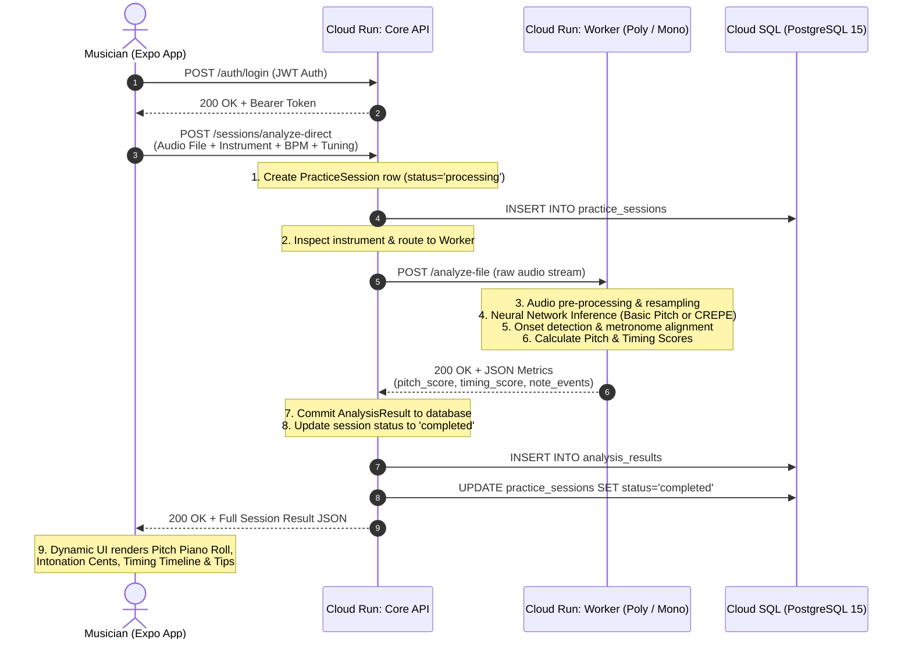
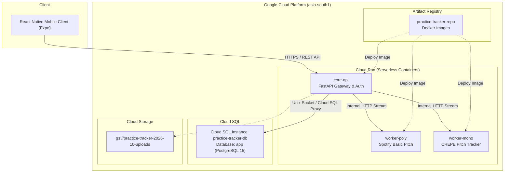
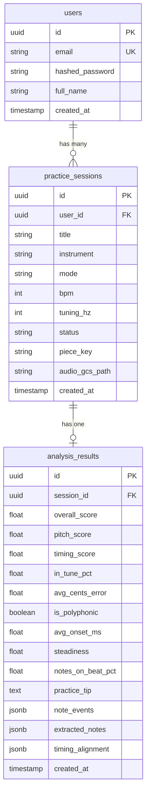

# Practice Tracker: Complete System Architecture & Cloud Engineering Guide

This document provides an exhaustive, end-to-end breakdown of the **Practice Tracker** system — detailing every component, logical workflow, Machine Learning pipeline, and the Google Cloud Platform (GCP) infrastructure.

---

## 1. System Overview & Executive Summary

**Practice Tracker** is an intelligent, AI-powered music performance analysis platform. A musician plays an instrument (such as Piano, Guitar, Violin, or sings), records or uploads their performance via the mobile app, and receives instant, deep quantitative feedback:
- **Pitch Accuracy**: Exact cents deviation from equal temperament, notes in tune vs. out of tune, and visual pitch contour.
- **Rhythm & Timing**: Beat-by-beat onset alignment, metronome synchronization, milliseconds early/late error, and tempo steadiness.
- **Progress Tracking**: Automatic clustering of practice sessions into "Pieces" to track mastery over days and weeks.

```
┌────────────────────────────────────────────────────────────────────────┐
│                          PRACTICE TRACKER                              │
├───────────────────┬───────────────────────────────────┬────────────────┤
│  Client Tier      │  Application & AI Tier (GCP)      │  Data Tier     │
│                   │                                   │                │
│  React Native     │  Cloud Run: Core API (FastAPI)    │  Cloud SQL     │
│  Expo Router      │  Cloud Run: Poly Worker (Basic    │  (Postgres 15) │
│  iOS / Android    │             Pitch ML)             │                │
│  Interactive SVG  │  Cloud Run: Mono Worker (CREPE)   │  Cloud Storage │
└───────────────────┴───────────────────────────────────┴────────────────┘
```

---

## 2. Component-by-Component Logical Breakdown

### 2.1 The Mobile Client Tier (`mobile/`)
- **Technology**: React Native (TypeScript) with Expo Router, Expo AV, and React Native SVG.
- **Responsibilities**:
  1. **Audio Capture**: Handles live audio recording with sample rate normalization (44.1kHz / 22.05kHz PCM) or file picking from the device filesystem (`.wav`, `.mp3`, `.m4a`).
  2. **Session Parameterization**:
     - **Instrument Selection**: Piano, Guitar, Violin, Voice, Flute, Cello, Trumpet.
     - **Mode Routing**: Polyphonic (chords/multi-note) vs. Monophonic (single melodic line).
     - **Tempo (BPM)**: Metronome tempo for rhythmic onset evaluation.
     - **Reference Tuning**: Standard Concert A = 440 Hz, Baroque A = 415 Hz, or custom Hz.
  3. **Data Visualization**:
     - Custom SVG **Piano Roll** rendering detected MIDI notes over a time axis with pitch error color encoding (Green: In-Tune, Amber: Slight Drift, Red: Out of Tune).
     - **Pitch Contour Curve**: Microtonal frequency line over target note bars.
     - **Rhythm Timeline**: Detected note onsets aligned against metronome beat markers with early/late indicators (e.g., `-18ms early`).

---

### 2.2 The Core API Tier (`services/core/`)
- **Technology**: Python 3.11, FastAPI, SQLAlchemy 2.0, Psycopg3, PyJWT, Pydantic.
- **Key Files**:
  - `main.py`: REST endpoints, session routing, authentication, and direct analysis proxying.
  - `models.py`: Database entities (`User`, `PracticeSession`, `AnalysisResult`).
  - `pieces.py`: Smart melody matching and session clustering algorithms.
- **Core Logical Aspects**:
  1. **Authentication & Authorization**: Password hashing with `bcrypt`, signed JWT access tokens with expiration.
  2. **Intelligent Worker Routing**:
     ```python
     # Determines which ML model to execute based on instrument and polyphony
     folder_type = "poly" if (mode and "poly" in mode.lower()) or (not mode and inst.lower() in ["piano", "guitar"]) else "mono"
     worker_host = WORKER_POLY_URL if folder_type == "poly" else WORKER_MONO_URL
     ```
  3. **Direct Processing Orchestration**: Receives multipart audio from the mobile client, forwards raw audio stream to the chosen ML worker via fast HTTP streaming, receives computed metrics, and commits them to the database within an ACID transaction.
  4. **Piece Clustering (`pieces.py`)**:
     - Normalizes piece names (e.g., "Minuet in G", "minuet_in_g_attempt2.wav").
     - Compares detected note signatures using sequence similarity algorithms (Levenshtein distance on MIDI sequences). If a user re-records the same melody under a different filename, the system automatically detects that it belongs to the same piece and displays historical progress charts.

---

### 2.3 The Machine Learning Worker Tier

#### A. Polyphonic Worker (`services/worker-poly/`)
- **Technology**: Spotify's **Basic Pitch** (TensorFlow / Librosa / SciPy).
- **Target Instruments**: Piano, Acoustic/Electric Guitar, Harpsichord, Synth chords.
- **How It Works**:
  1. Basic Pitch runs a deep convolutional and recurrent neural network designed by Spotify Research that simultaneously predicts note onset events, note activation probabilities, and pitch bend contours across all 88 piano keys.
  2. Unlike classic monophonic trackers which fail when two notes sound at once, Basic Pitch can separate polyphonic chords (e.g., C-E-G played together).
  3. The worker converts raw neural network activations into discrete `note_events` containing:
     - `midi`: MIDI note number (e.g., 60 = Middle C).
     - `label`: Musical pitch name (e.g., "C4").
     - `onset_s` & `offset_s`: Precise start and end time in seconds.
     - `confidence`: Neural network probability (0.0 to 1.0).
     - `cents_error`: Intonation drift in cents (100 cents = 1 semitone).

#### B. Monophonic Worker (`services/worker-mono/`)
- **Technology**: **CREPE** (Convolutional Representation for Pitch Estimation) + Librosa.
- **Target Instruments**: Voice, Violin, Viola, Cello, Flute, Trumpet, Clarinet.
- **How It Works**:
  1. CREPE is an operating-standard pitch estimation model trained on synthetic and acoustic sounds with ground-truth pitch.
  2. It evaluates 1024-sample audio windows and outputs continuous fundamental frequency ($f_0$) estimates every 10 milliseconds.
  3. It detects vibrato width, vocal scoops, portamento, and calculates instantaneous intonation errors:
     $$\text{cents} = 1200 \times \log_2\left(\frac{f_0}{f_{\text{target}}}\right)$$

#### C. Timing & Rhythm Scoring Engine
Both workers share a rhythmic analysis engine:
1. **Onset Detection**: Spectral flux and energy peak picking identify exact moments when strings are struck or notes are articulated.
2. **Beat Tracking**: Analyzes audio periodicity to detect tempo (BPM) or locks onto the user's selected BPM.
3. **Synchronization**: Compares each note onset against the closest theoretical metronome beat grid:
   - Onsets within $\pm 35\text{ms}$ are classified as **On-Beat**.
   - Onsets outside $\pm 35\text{ms}$ are flagged with exact millisecond early/late errors.
   - Calculates **Tempo Steadiness** via onset standard deviation.

---

## 3. Full Architectural Flow & Data Lifecycle

The following diagram illustrates the complete end-to-end lifecycle of an audio practice session:



---

## 4. Google Cloud Platform (GCP) Infrastructure

All backend components run entirely on Google Cloud Platform in the **`asia-south1` (Mumbai)** region.



---

## 5. What Was Created in Cloud and Why

| GCP Resource | Resource Identifier | Purpose & Justification |
| :--- | :--- | :--- |
| **Artifact Registry** | `asia-south1-docker.pkg.dev/practice-tracker-2026-10/practice-tracker-repo` | **Container Image Repository**: Houses versioned, production-ready Docker images for `core-api`, `worker-poly`, and `worker-mono`. Ensures reproducible, containerized deployments. |
| **Cloud SQL (PostgreSQL 15)** | `practice-tracker-db`<br>(Connection: `practice-tracker-2026-10:asia-south1:practice-tracker-db`) | **Relational Database**: Replaced temporary local SQLite with high-performance, ACID-compliant PostgreSQL 15. Stores users, practice sessions, note events, and long-term history safely. |
| **Cloud Run: Core API** | `core-api`<br>([Endpoint](https://core-api-571568987946.asia-south1.run.app)) | **API Gateway & Orchestrator**: Handles user authentication, session state management, and coordinates worker tasks. Connected directly to Cloud SQL via secure Unix domain sockets. |
| **Cloud Run: Worker Poly** | `worker-poly`<br>([Endpoint](https://worker-poly-571568987946.asia-south1.run.app)) | **Polyphonic AI Inference**: Dedicated container running TensorFlow and Spotify's Basic Pitch. Configured with 2 vCPUs and 2 GiB RAM for rapid musical transcription. |
| **Cloud Run: Worker Mono** | `worker-mono`<br>([Endpoint](https://worker-mono-571568987946.asia-south1.run.app)) | **Monophonic AI Inference**: Dedicated container running CREPE for sub-cent microtonal analysis of voice and solo string instruments. |
| **Cloud Storage (GCS)** | `practice-tracker-2026-10-uploads` | **Blob Storage**: Scalable, durable object storage for raw audio recordings, allowing playback and archive access without overloading the database. |

---

## 6. Why Cloud Architecture Is Beneficial for This Project

1. **Heavy ML Inference Offloading**:
   - Running deep learning neural networks (TensorFlow, Basic Pitch, CREPE) directly on mobile devices drains battery, overheats mobile chips, and results in 500MB+ app download sizes.
   - Offloading inference to Cloud Run containers allows models to execute in seconds on multi-core cloud CPUs without taxing the user's phone.

2. **Serverless Auto-Scaling (Zero Cost When Idle)**:
   - Google Cloud Run is fully serverless: it automatically scales instances from **0 to N** based on concurrent traffic.
   - When no users are practicing, instances scale to zero — eliminating ongoing server costs. When multiple musicians practice simultaneously, Cloud Run spins up parallel container instances in milliseconds.

3. **Decoupled Microservice Architecture**:
   - The Core API and ML workers are isolated. If Spotify Basic Pitch undergoes an update or requires additional memory, `worker-poly` can be rebuilt and deployed independently without touching the user database or auth services.

4. **Production-Grade Reliability & Data Durability**:
   - Cloud SQL provides automated daily backups, point-in-time recovery, automatic disk resizing, and enterprise security.
   - Database credentials and connections use Cloud SQL proxy unix sockets (`/cloudsql/...`), keeping the database inaccessible to unauthorized external traffic.

5. **Low Latency Regional Colocation**:
   - All services (Cloud Run, Cloud SQL, Artifact Registry) are colocated in `asia-south1` (Mumbai), minimizing network transit latency between services to sub-5ms.

---

## 7. Database Schema & Data Models

The PostgreSQL database `app` in Cloud SQL consists of three core relational tables:



- **`note_events` (JSONB)**: Stores the exact array of notes calculated by the AI:
  ```json
  [
    {
      "midi": 60,
      "label": "C4",
      "onset_s": 0.42,
      "offset_s": 0.98,
      "confidence": 0.91,
      "cents_error": -4.2,
      "expected_midi": 60
    }
  ]
  ```
- This dynamic JSON structure allows the mobile app to render notes on the Piano Roll and Timing Timeline for any uploaded audio.

---

## 8. Summary of Development & Deployment Operations

1. **Local Development to Containerization**:
   - Encapsulated Core API and ML workers into standalone Docker containers with explicit pinned dependencies.
2. **Cloud SQL Migration**:
   - Provisioned PostgreSQL 15 instance `practice-tracker-db` in `asia-south1`.
   - Connected `core-api` using `psycopg3` and Cloud SQL unix socket connection.
3. **Continuous Cloud Deployment**:
   - Built and pushed container images to Google Artifact Registry.
   - Deployed and configured revisions on Cloud Run with environment variables (`DATABASE_URL`, `JWT_SECRET`, `WORKER_POLY_URL`, `WORKER_MONO_URL`).
4. **End-to-End Verification**:
   - Synthetic acoustic tests proved that audio uploaded to Cloud Run is routed to the neural network worker, accurately transcribed into MIDI notes, and persisted to Cloud SQL in real-time.
